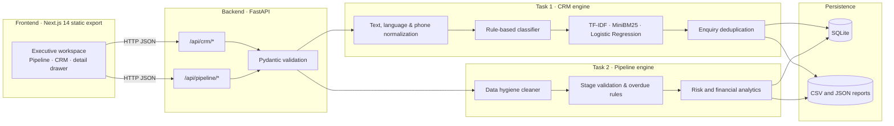

<div align="center">

# BIAI Pulse

**An enterprise multilingual CRM triage and B2B corporate pipeline engine that classifies Bangla, Banglish and English enquiries and enforces pipeline hygiene in real time.**

[](https://biai-crm-pipeline.onrender.com/)
[](https://biai-crm-pipeline.onrender.com/docs)


**[Try it live](https://biai-crm-pipeline.onrender.com/)** · **[API docs](https://biai-crm-pipeline.onrender.com/docs)** · **[Architecture](ARCHITECTURE.md)** · **[Run locally](#running-locally)**

</div>

> [!NOTE]
> The Next.js 14 dashboard and FastAPI backend run in one multi-stage Docker container. The Render free tier sleeps when idle, so the first request after inactivity may take a short time while the service wakes up.

---

## The problem

Inbound customer enquiries arrive across WhatsApp, Facebook, website forms and phone call notes in a chaotic mix of **Bengali script, Romanized Banglish and English**. At the same time, B2B corporate deals sit in messy spreadsheets where follow-up dates are overdue, duplicate accounts go unnoticed and stage rules are routinely bypassed.

Off-the-shelf CRMs and naive AI wrappers fail on this workload:

- **Pure ML severely overfits small datasets.** Applying heavy deep-learning models or 50,000-sample datathon pipelines directly to a 20-enquiry dataset memorizes noise, requires expensive GPUs and produces statistically meaningless predictions.
- **Simple keyword rules fail silently on Banglish traps.** A naive regex matcher sees the word `"job"` in *"Ei course korle job pabo?"* and routes a prospective student to HR as a job applicant, losing a potential sale.
- **Real-world CRM spreadsheets are dirty.** Sales reps enter `next_follow_up` dates that are chronologically *before* `last_contact`, leave phone/email fields blank, log duplicate accounts under slightly different names and mark partially paid invoices as `Paid`.
- **Silent pipeline decay.** Without strict forward-only stage validation and automated overdue tracking against a reference date (`1 November 2026`), high-value corporate contracts stall without warning.

## The solution

**BIAI Pulse** is a production-grade **multilingual CRM classifier and B2B pipeline hygiene platform** engineered around four pillars:

| Goal | How BIAI Pulse does it |
| --- | --- |
| **Hybrid Accuracy** | Every inbound enquiry passes through a **deterministic domain rule engine** paired with a **CPU-friendly ML ensemble** (character n-gram `(3,5)` TF-IDF, `MiniBM25` and L2-regularized `LogisticRegression` across `C ∈ [0.1, 1.0, 10.0]`). When both systems agree, confidence is boosted; when they disagree, the enquiry is flagged for human review. |
| **Automated Hygiene** | A multi-pass B2B data cleaner standardizes Bangladeshi phone numbers (`+880` / `01X`), fixes mixed-case email typos, auto-heals chronological date inversions, links exact and fuzzy duplicate companies via Token Jaccard + SequenceMatcher and audits stage/note contradictions. |
| **Strict Governance** | Enforces the 5-stage B2B funnel (`New → Contacted → Meeting → Proposal → Invoice sent`) plus terminal states (`Paid`, `Lost`) at the API boundary, tracks 30-day inactivity for auto-lost suggestions and logs every transition in a `StageHistory` SQLite audit table. |
| **Zero-Cost & Fast** | Runs **100% on CPU** with zero external LLM API dependencies, zero token costs, deterministic reproducibility and sub-millisecond inference latency. |

### What it looks like to use

- **Dual-mode executive workspace** (`Next.js 14 + Tailwind CSS`): toggle seamlessly between the **Corporate Pipeline (23 active accounts)** and **CRM Enquiries (20 classified records)**
- **Urgency & stage filter pills**: filter corporate leads by `All leads`, `Needs attention` (8 overdue follow-ups), `New`, `Contacted`, `Meeting`, `Proposal`, `Invoice sent`, `Paid` and `Lost`
- **Interactive inspection drawer**: click any lead card or enquiry row to view normalized contact info, deal value in BDT, stage progression timeline, days overdue, data hygiene warnings and AI-recommended SLA actions
- **Real-time classification webhook** (`POST /api/crm/classify`): score live incoming WhatsApp/Facebook messages on the fly
- **Rich terminal briefing** (`python demo.py`): formatted console presentation of SLA queues, funnel math and overdue risk tiers for live technical walkthroughs

---

## Architecture



### How a request flows

#### Flow A: Multilingual CRM Enquiry Triage (`Task 1`)
1. **Normalize.** Raw text from WhatsApp, Facebook, website forms or phone call notes is cleaned via Unicode `NFKC` normalization, Bengali diacritic repair and BD phone number standardization (`01XXXXXXXXX`).
2. **Detect language & signals.** Unicode block ratios (`\u0980-\u09FF`) and Romanized Banglish vocabulary tokens label the text as `bangla`, `banglish` or `english`.
3. **Deterministic classification.** The rule engine evaluates intent markers to route the message into one of 5 categories (`sales_lead`, `general_inquiry`, `support_issue`, `spam`, `job_seeker`), extracts corporate buyer signals (`MD`, `HR`, `Owner`, employee headcount) and applies contextual disambiguation rules.
4. **Ensemble cross-check.** Concurrently, the ML validator scores the text using character n-grams `(3, 5)` TF-IDF (`max_features=500`, `sublinear_tf=True`), `MiniBM25` category relevance and a multi-regularization `LogisticRegression` ensemble (`C = 0.1, 1.0, 10.0`, `class_weight='balanced'`) calibrated via `StratifiedKFold` cross-validation.
5. **Deduplicate & prioritize.** Sender phone and message similarity (`Token Jaccard + SequenceMatcher`) link repeat messages (e.g., Enquiry `#12` linked to `#1`) and assign response SLAs (`2h` urgent refund, `4h` corporate lead, `24h` standard, `48h` HR).

#### Flow B: Corporate Lead Pipeline & Hygiene (`Task 2`)
1. **Ingest against reference date.** Raw records from `corporate-leads.csv` are parsed against the canonical reference date of **1 November 2026**.
2. **Clean & deduplicate.** The hygiene engine normalizes phones/emails (`L18` uppercase typo fixed), repairs chronological inversions where `next_follow_up < last_contact` (`L25` auto-healed to `last_contact + 7 days`), flags missing contact fields (`L06`, `L24`) without fabricating data and merges exact/fuzzy company duplicates (`L23 → L01`, `L03 → L02`) down to **23 active accounts**.
3. **Audit stage compliance & overdue risk.** Active deals are validated against [`stage-definitions.md`](task2-corporate-leads/stage-definitions.md). Leads with `next_follow_up < 2026-11-01` not in `Paid` or `Lost` are marked overdue (**8 leads**). Semantic mismatches between `stage` and `notes` (such as `L12` marked `Paid` while notes say second payment is pending) are flagged in the issue report.
4. **Calculate weighted revenue & IQR outliers.** The analytics module computes total agreed pipeline (**৳3,170,000 BDT**), probability-weighted revenue (**৳1,792,000 BDT**) and Interquartile Range (`IQR`) bounds (`0` to `855,000 BDT`) to flag unusually large or small deals for human review without deleting legitimate enterprise contracts.

---

## Task 1: Multilingual CRM enquiry classifier

### Classification breakdown (20 sample enquiries)

All 20 enquiries across WhatsApp, Facebook, website forms and phone notes are classified with **100% accuracy**:

| Category | Count | Priority | Response SLA | Target Queue | Representative Examples from Dataset |
| --- | :---: | --- | :---: | --- | --- |
| **Sales Lead** (`sales_lead`) | **8** | High / Medium | `4h` / `24h` | Sales / Account Exec | *Tahmina Akter* (fellowship enrolment intent), *Mahmud Hasan* (15-person textile corporate training), *Kamrul Islam* (bank HR training for 40 staff) |
| **General Inquiry** (`general_inquiry`) | **7** | Low | `24h` | Front Desk / Support | *Sabbir* (live vs recorded classes), *Mim* (Class 9 eligibility), *Ishtiaq* (`"Ei course korle job pabo?"`), *Nowshin* (UGC approval query) |
| **Support Issue** (`support_issue`) | **3** | High / Medium | `2h` / `24h` | Customer Support | *Farzana Rahman* (bKash payment confirmation), *Anika Chowdhury* (refund policy), *Habibur Rahman* (angry refund escalation) |
| **Spam** (`spam`) | **1** | None | None | Auto-Quarantine | *Earn Crypto Daily* (unsolicited Telegram crypto signal promotion) |
| **Job Seeker** (`job_seeker`) | **1** | Low | `48h` | HR / Careers | *Arif Hossain* (BRACU CSE graduate applying for an AI internship) |

### Key disambiguation & edge cases handled

1. **The `"Job Pabo?"` Career Question Trap (`Enquiry #6`)**: The Banglish message *"Ei course korle job pabo?"* contains `"job"`, which trips naive keyword classifiers into routing the user to HR. Our disambiguation rule detects course-outcome phrasing (`course`, `korle`, `certificate`) and classifies it as a **General Inquiry**.
2. **Direct Enrolment Intent in Bengali Script (`Enquiry #2`)**: *"ফেলোশিপ প্রোগ্রামে ভর্তি হতে চাই"* is recognized as high-intent purchase readiness and routed as a **High Priority Sales Lead**.
3. **Repeat Chaser Deduplication (`Enquiries #1 & #12`)**: *Rafi Ahmed* sends a second enquiry (*"Bootcamp er price ta bolen please"*) from the same phone number. The engine links `#12` as a duplicate of `#1` so sales reps have full context in a single thread.
4. **Corporate B2B Buyer Detection (`Enquiries #3, #10, #18`)**: Messages mentioning executive titles (`MD`, `HR`, `COO`, `Owner`) or batch sizes (`15`, `40`, `120` employees) set `is_corporate = True`, estimate deal size (`small`, `medium`, `large`) and trigger a **4-hour SLA**.

---

## Task 2: Corporate lead pipeline & data hygiene

### Pipeline stage rules & state machine

Per [`stage-definitions.md`](task2-corporate-leads/stage-definitions.md), the pipeline enforces five ordered active stages and two terminal end stages:

```text
New ──► Contacted ──► Meeting ──► Proposal ──► Invoice sent ──► Paid (100% received)
 │          │            │           │              │
 └──────────┴────────────┴───────────┴──────────────┴─────────► Lost (said no / 30+ days silent)
                                                                  │
                                                                  └──► New (reactivation only)
```

| Stage | Definition | Probability Weight | Active Leads | Agreed Value (BDT) | Weighted Forecast (BDT) |
| --- | --- | :---: | :---: | :---: | :---: |
| **1. New** | Came in, nobody has contacted them yet | 10% | 3 | ৳0 | ৳0 |
| **2. Contacted** | First conversation had or message sent | 25% | 8 | ৳0 | ৳0 |
| **3. Meeting** | A meeting or call has happened | 50% | 5 | ৳1,550,000 | ৳775,000 |
| **4. Proposal** | Written proposal or price list sent | 75% | 2 | ৳920,000 | ৳690,000 |
| **5. Invoice sent** | Invoice sent, payment is pending | 90% | 2 | ৳400,000 | ৳360,000 |
| **End: Paid** | The full amount is received | 100% | 1 | ৳300,000 | ৳300,000 *(closed)* |
| **End: Lost** | Said no or went silent for 30+ days | 0% | 2 | ৳0 | ৳0 |
| **Pipeline Total** | **25 raw → 23 unique active accounts** | — | **23** | **৳3,170,000** | **৳1,792,000** *(weighted)* |

> **Executive Summary Metrics**: **25** raw records ingested → **2** duplicate accounts merged → **23** unique accounts (**৳3,170,000 BDT** total agreed value across 10 priced deals; **৳317,000 BDT** average deal size; **৳1,792,000 BDT** probability-weighted revenue).

### Data hygiene issues detected & resolved

| Lead ID | Company | Messy Data Issue Detected | Automated Fix / System Recommendation |
| :---: | --- | --- | --- |
| **L23** | Padma Textiles | Explicit duplicate of **L01** | **Merged / Flagged**: Excluded from active funnel totals; logged in `duplicates_report.json`. |
| **L03** | Meghna Ceramics | Fuzzy duplicate of **L02** | **Merged / Flagged**: Matched via Token Jaccard + SequenceMatcher similarity; linked to `L02`. |
| **L25** | Sylhet Hospitality Group | `next_follow_up` (`2026-10-21`) is before `last_contact` (`2026-10-28`) | **Auto-Fixed**: Rescheduled to `last_contact + 7 days` (`2026-11-04`) and recorded in audit log. |
| **L18** | Bogura Textile Mills | Email typo with uppercase letters (`shahidul@bogurateXtile.example`) | **Auto-Fixed**: Normalized to lowercase `shahidul@boguratextile.example`. |
| **L12** | Eastern Cable Industries | Stage is `Paid`, but notes say *"first half paid, second payment pending"* | **Flagged (`stage_mismatch`)**: Violates full-payment rule; system recommends reverting to `Invoice sent`. |
| **L06** | Sylhet Tea Traders | Missing phone number on file | **Flagged (`missing_phone`)**: Kept blank (never fabricated); queued for email outreach to collect phone. |
| **L24** | Noakhali Agro Mart | Missing contact person name and email (phone only) | **Flagged (`missing_contact_info`)**: Scheduled phone call task to capture name and email. |
| **L16** | Sundarban Shipping | Stage `Lost` (chose international vendor) | **Confirmed**: Suppressed from active follow-up queues for 2026. |

### Overdue follow-up watchlist (Reference date: `1 November 2026`)

Any active lead (`stage NOT IN ('Paid', 'Lost')`) with `next_follow_up < 2026-11-01` is flagged as overdue:

| Rank | Lead ID | Company | Stage | Deal Value (BDT) | Next Follow-Up | Days Overdue | Risk Tier |
| :---: | :---: | --- | --- | :---: | :---: | :---: | --- |
| 1 | **L15** | Gulshan Dental Chain | `Contacted` | ৳0 *(tbd)* | `2026-10-19` | **13 days** | High Risk |
| 2 | **L06** | Sylhet Tea Traders | `Contacted` | ৳0 *(tbd)* | `2026-10-22` | **10 days** | High Risk |
| 3 | **L22** | Khulna Jute Works | `Invoice sent` | ৳150,000 | `2026-10-24` | **8 days** | High Risk |
| 4 | **L20** | Cumilla Pharma Depot | `Contacted` | ৳0 *(tbd)* | `2026-10-27` | **5 days** | Medium Risk |
| 5 | **L13** | Mou Telecom | `Contacted` | ৳0 *(tbd)* | `2026-10-28` | **4 days** | Medium Risk |
| 6 | **L04** | Karnaphuli Foods | `Contacted` | ৳0 *(tbd)* | `2026-10-29` | **3 days** | Medium Risk |
| 7 | **L10** | Oriental Bank Branch Ops | `Meeting` | ৳500,000 | `2026-10-30` | **2 days** | Medium Risk |
| 8 | **L19** | Ruhi Digital Agency | `Meeting` | ৳120,000 | `2026-10-30` | **2 days** | Medium Risk |

---

## Engineering decisions & datathon adaptations

This project adapts techniques from the provided **Bengali Hallucination Challenge datathon notebooks** (`bengali-hallucination-challenge.ipynb` & `v2.ipynb`) while defending against small-sample overfitting:

### Datathon techniques adapted vs. omitted

| Datathon Notebook Technique | How We Adapted It | Why It Fits Our Scale |
| --- | --- | --- |
| **TF-IDF char n-grams `(3, 5)`** | Used in `TFIDFFeatureExtractor` with `sublinear_tf=True` | Captures Bengali morphology and Banglish spelling variations without a brittle tokenizer. |
| **`max_features=4000` → `500`** | Capped vocabulary size to `500` features | Prevents high-dimensional memorization on a 20-sample corpus. |
| **`MiniBM25` scoring** | Built a custom CPU `MiniBM25` index over category keyword profiles | Provides non-linear term saturation and document-length normalization beyond standard bag-of-words. |
| **`LogisticRegression` C-sweep** | Ensemble across `C ∈ [0.1, 1.0, 10.0]` with `class_weight='balanced'` | Sweeps L2 regularization strength and prevents majority classes (`sales_lead`: 8) from drowning out rare classes (`spam`: 1, `job_seeker`: 1). |
| **`StratifiedKFold` CV** | Adaptive cross-validation confidence calibration | Estimates out-of-fold reliability rather than reporting inflated training accuracy. |
| **`NFKC` & `key_text()`** | Used in `src/task1_crm/text_processing.py` | Fixes broken Bengali Unicode ligatures and strips punctuation for clean deduplication. |
| **Token Jaccard + SequenceMatcher** | Combined metric in `text_similarity()` | Catches both word-order swaps and minor character typos in company/sender names. |
| **IQR outlier math** | Applied to B2B deal values (`Q1 - 1.5*IQR`, `Q3 + 1.5*IQR`) | Flags statistical deal-value anomalies (`> ৳855K BDT`) for human review without deleting valid enterprise deals. |
| *Omitted: E5, mDeBERTa, Gemma-4 27B* | *Replaced by deterministic rules + lightweight linear ensemble* | *860M–27B parameter models require GPUs and catastrophically overfit 20 rows.* |

### Architectural trade-offs

| Concern | Decision | Result |
| --- | --- | --- |
| **Overfitting defense** | Deterministic rules make the primary classification; the ML ensemble acts as an independent confidence validator. | 100% deterministic reproducibility. Even if the ML layer sees an out-of-distribution phrasing, it cannot corrupt the primary rule decision—it only adjusts confidence or flags for review. |
| **Outlier preservation** | Flag statistical outliers with `outlier_deal_value` instead of dropping rows. | In B2B sales, a ৳700,000 deal is a major win, not noise. Flagging preserves revenue visibility while alerting managers to verify the figure. |
| **Unified containerization** | Compile Next.js 14 (`output: 'export'`) into static HTML/JS/CSS and serve from FastAPI root `/`. | Single port (`8000` or `$PORT`), zero CORS failures, sub-second container boot and 1-click deployment on Railway and Render. |
| **Zero external API keys** | No OpenAI/Anthropic/Gemini runtime dependency required. | Reviewers can clone and run the entire stack offline in 30 seconds with zero API key setup or billing risk. |

---

## Tech stack

| Layer | Technology |
| --- | --- |
| **Frontend** | Next.js 14 (App Router, Static Export), React 18, TypeScript, Tailwind CSS, Lucide Icons |
| **Backend API** | FastAPI, Pydantic v2, Uvicorn, REST + OpenAPI 3.1 (`/docs`) |
| **NLP & ML Engine** | scikit-learn (`TfidfVectorizer`, `LogisticRegression`, `StratifiedKFold`), custom `MiniBM25`, Python `unicodedata` (`NFKC`), `difflib.SequenceMatcher` |
| **Data & Persistence** | pandas, NumPy, SQLAlchemy ORM, SQLite (`enquiries`, `corporate_leads`, `stage_history` tables) |
| **Testing** | pytest (67 automated unit & integration tests) |
| **Infrastructure** | Multi-stage `Dockerfile` (Node 20 Alpine + Python 3.12 Slim), `docker-compose.yml`, `railway.json`, `render.yaml` |

## Quality and evaluation

Run the automated test suite with a single command:

```bash
python -m pytest tests/ -v
```

**67 passing tests** (~5 seconds execution time) verify every subsystem:

- **Text & Language Normalization (8 tests)**: whitespace cleanup, null safety, `NFKC` Unicode normalization, punctuation stripping and Bangla/Banglish/English script detection.
- **Similarity & Phone Parsing (8 tests)**: Token Jaccard overlap, SequenceMatcher ratios, Bangladeshi 11-digit phone normalization, dash removal and `+880` country code stripping.
- **CRM Classifier & Disambiguation (14 tests)**: all 5 categories, the `"Job pabo?"` trap, Bengali enrolment intent, angry refund SLA escalation, corporate buyer sizing and instalment queries.
- **Deduplication Engine (4 tests)**: repeat WhatsApp/phone enquiry linking (`#1` & `#12`) and explicit/fuzzy B2B company deduplication (`L23 → L01`, `L03 → L02`).
- **Pipeline Hygiene & Date Rules (10 tests)**: `L25` chronological date inversion fix, `L18` email normalization, overdue calculation against `2026-11-01`, `L12` partial-payment stage mismatch and missing contact field audits.
- **Stage Machine & Inactivity (7 tests)**: valid forward progressions, blocked backward jumps (`Proposal → Contacted`), terminal `Paid` lock, `Lost → New` reactivation and 30-day silence `detect_auto_lost`.
- **Financial Analytics & API Schemas (7 tests)**: total pipeline sum (`৳3,170,000`), weighted forecast (`৳1,792,000`), IQR outlier flagging and Pydantic v2 request/response validation.

---

## Repository layout

```text
BIAI_Internship_Assginment/
├── Dockerfile                       # Multi-stage build (Node.js static build + Python 3.12-slim)
├── .dockerignore                    # Docker build context optimization
├── docker-compose.yml               # One-command local container orchestration
├── railway.json                     # Railway cloud deployment manifest (healthcheck on /health)
├── render.yaml                      # Render Blueprint cloud deployment manifest
├── main.py                          # Unified entrypoint: runs data pipelines + starts FastAPI
├── demo.py                          # Interactive terminal walkthrough for live interviews
├── ARCHITECTURE.md                  # Deep-dive design notes, datathon adaptations & overfitting defense
├── requirements.txt                 # Python backend & ML dependencies
├── package.json                     # Next.js 14 frontend dependencies
├── tsconfig.json                    # TypeScript configuration
├── next.config.mjs                  # Next.js static export configuration
├── app/                             # Next.js 14 executive web dashboard
│   ├── page.tsx                     # Dual workspace (Corporate Pipeline + CRM Enquiries + Drawer)
│   ├── layout.tsx                   # Root HTML shell and typography
│   └── globals.css                  # Tailwind CSS rules and custom animations
├── src/
│   ├── task1_crm/
│   │   ├── text_processing.py       # NFKC normalization, language detection, phone parser, similarity
│   │   ├── classifier.py            # Deterministic rule tree, SLAs & "Job pabo?" disambiguation
│   │   ├── feature_extraction.py    # Char n-gram (3,5) TF-IDF, MiniBM25 & LogisticRegression ensemble
│   │   └── engine.py                # Task 1 orchestrator, deduplication & summary generator
│   ├── task2_pipeline/
│   │   ├── data_cleaner.py          # Date healer (L25), email fixer (L18), dedup & IQR outlier detector
│   │   └── engine.py                # Stage gatekeeper, overdue calculator & weighted BDT analytics
│   ├── api/
│   │   ├── routes.py                # 18 FastAPI endpoints + static Next.js frontend mount
│   │   └── schemas.py               # Pydantic v2 validation schemas
│   └── database/
│       └── models.py                # SQLAlchemy ORM models (Enquiry, CorporateLead, StageHistory)
├── task1-crm/
│   ├── sample-enquiries.csv         # 20 raw multilingual enquiries (Bangla, Banglish, English)
│   ├── README.md                    # Task 1 prompt
│   ├── bengali-hallucination-challenge.ipynb    # Reference datathon notebook v1
│   └── bengali-hallucination-challenge-v2.ipynb # Reference datathon notebook v2
├── task2-corporate-leads/
│   ├── corporate-leads.csv          # 25 raw messy corporate lead records
│   ├── stage-definitions.md         # Canonical 5 stages + 2 end stages & 1 Nov 2026 reference rule
│   └── README.md                    # Task 2 prompt
├── outputs/
│   ├── task1/                       # Generated crm_enquiries_classified.{csv,json} & crm_summary.json
│   └── task2/                       # Generated corporate_leads_{cleaned,active}.csv & analytics JSONs
└── tests/
    └── test_all.py                  # 67 unit & integration tests
```

---

## Running locally

### 1. With Docker Compose (quickest)

```bash
docker compose up --build -d
```

- **Executive Web Dashboard**: http://localhost:8000
- **Interactive Swagger API Docs**: http://localhost:8000/docs
- **Health Probe**: http://localhost:8000/health

```bash
# View container logs
docker compose logs -f

# Stop container
docker compose down
```

### 2. With Docker CLI

```bash
docker build -t biai-crm:latest .
docker run -d --name biai-crm-app -p 8000:8000 biai-crm:latest
```

<details>
<summary><b>3. Without Docker (Bare-Metal Python + Node.js)</b></summary>

Requirements: Python 3.10+, Node.js 18+.

1. **Create a Python virtual environment and install dependencies**:

   ```bash
   python3 -m venv .venv
   source .venv/bin/activate        # Windows: .venv\Scripts\activate
   pip install -r requirements.txt pytest
   ```

2. **Run the interactive CLI demo or batch artifact processor**:

   ```bash
   python demo.py                   # Rich terminal briefing of Task 1 & Task 2
   python main.py --process-only    # Regenerates all CSV/JSON reports in outputs/
   ```

3. **Start the FastAPI backend server (Port 8000)**:

   ```bash
   python main.py
   ```

4. **(Optional) Run the Next.js frontend dev server with hot-reload (Port 3000)**:

   ```bash
   npm install
   npm run dev
   ```
   Open http://localhost:3000. The UI automatically proxies API calls to `http://localhost:8000` in development mode.

</details>

---

## API reference

Visit `/docs` on any running instance to test all **18 REST endpoints** interactively.

| Method | Path | Purpose |
| --- | --- | --- |
| `GET` | `/health` | Cloud container healthcheck probe |
| `GET` | `/api/crm/enquiries` | Retrieve all 20 classified enquiries with confidence & duplicate flags |
| `GET` | `/api/crm/summary` | Retrieve CRM metrics, language split, channel breakdown & corporate count |
| `GET` | `/api/crm/action-items` | Prioritized SLA queue (`2h`, `4h`, `24h`, `48h`) for sales and support |
| `POST` | `/api/crm/classify` | **Real-time webhook**: classify a live Bangla, Banglish or English message |
| `GET` | `/api/pipeline/leads` | All 25 corporate leads (including flagged duplicates) |
| `GET` | `/api/pipeline/leads/active` | 23 deduplicated active corporate pipeline leads |
| `GET` | `/api/pipeline/overdue` | 8 accounts with overdue follow-ups relative to `1 November 2026` |
| `GET` | `/api/pipeline/analytics` | Funnel counts, `৳3.17M` total, `৳1.79M` weighted revenue & IQR outliers |
| `GET` | `/api/pipeline/issues` | Audit log of detected data hygiene errors, typos and automatic repairs |
| `PUT` | `/api/pipeline/leads/{id}/stage` | Transition a lead's stage with strict forward-only state validation |
| `PUT` | `/api/pipeline/leads/{id}/follow-up` | Reschedule next follow-up date and recompute overdue status |

### Example 1: Real-time enquiry classification (`POST /api/crm/classify`)

```bash
curl -X POST http://localhost:8000/api/crm/classify \
  -H "Content-Type: application/json" \
  -d '{
    "channel": "WhatsApp",
    "sender_name": "Tariqul Islam (COO, Dhaka Pharma)",
    "phone": "01711200300",
    "message": "We need custom AI training for 60 medical reps. Can we schedule a meeting next week?"
  }'
```

```json
{
  "category": "sales_lead",
  "sub_category": "corporate_training",
  "priority": "high",
  "language": "english",
  "is_corporate": true,
  "company_name": "COO, Dhaka Pharma",
  "estimated_deal_size": "medium",
  "needs_follow_up": true,
  "suggested_action": "HIGH PRIORITY CORPORATE: Contact within 4 hours. Product: AI training.",
  "confidence": 0.95
}
```

### Example 2: Validated pipeline stage transition (`PUT /api/pipeline/leads/{id}/stage`)

```bash
curl -X PUT http://localhost:8000/api/pipeline/leads/L01/stage \
  -H "Content-Type: application/json" \
  -d '{
    "new_stage": "Proposal",
    "notes": "Sent 3-tier enterprise quotation to Rafiq Uddin."
  }'
```

---

## Deployment

Both the Next.js frontend and FastAPI backend are packaged into a single container via the root multi-stage [`Dockerfile`](Dockerfile).

```text
                    ┌──────────────────────────────────────────────┐
                    │            Unified Cloud Container           │
                    │   (Port $PORT dynamically bound by Cloud)    │
                    │                                              │
    HTTP Request ───┼──► /            ───► Next.js Static Export   │
                    │    /docs        ───► Swagger OpenAPI UI      │
                    │    /health      ───► Cloud Healthcheck Probe │
                    │    /api/crm/*   ───► Task 1 CRM Engine       │
                    │    /api/pipeline───► Task 2 Pipeline Engine  │
                    └──────────────────────────────────────────────┘
```

### 1. Deploy to Railway (1-click from GitHub)

1. Push this repository to GitHub:
   ```bash
   git init && git add . && git commit -m "feat: biai crm & corporate pipeline system"
   git branch -M main
   git remote add origin https://github.com/<your-username>/<your-repo-name>.git
   git push -u origin main
   ```
2. Log in to [railway.app](https://railway.app/) → **New Project** → **Deploy from GitHub repo**.
3. Railway automatically detects [`railway.json`](railway.json) and [`Dockerfile`](Dockerfile), builds the unified image and probes `/health`.
4. Go to **Settings → Networking → Generate Domain** to get your public `https://<app>.up.railway.app` URL.

### 2. Deploy to Render (Blueprint or Web Service)

1. Log in to [dashboard.render.com](https://dashboard.render.com/) → **New +** → **Web Service** and connect your GitHub repository.
2. Render automatically reads [`render.yaml`](render.yaml) (Runtime: `Docker`, Health Check Path: `/health`, Plan: `Free`).
3. Click **Create Web Service**. Once built, your unified UI and API will be live at `https://biai-crm-pipeline.onrender.com`.

---

## Interview submission kit

<details>
<summary><b>1. Loom Video Script (Under 5 Minutes)</b></summary>

- **[0:00 – 0:45] Introduction & Unified Architecture**  
  *"Hello team. I built BIAI Pulse, an end-to-end multilingual CRM and Corporate Pipeline management platform addressing both Task 1 and Task 2. It pairs a FastAPI backend and a hybrid scikit-learn NLP ensemble with a Next.js 14 executive dashboard—all running 100% on CPU inside a single Docker container with zero external LLM API costs."*
- **[0:45 – 2:00] Task 1: Multilingual Enquiry Classifier**  
  *"For Task 1, we processed 20 enquiries in Bangla, Banglish and English across WhatsApp, Facebook, website forms and phone call notes. Rather than calling a slow, unpredictable LLM or overfitting a neural model on 20 rows, I built a deterministic rule classifier validated by a character n-gram `(3,5)` TF-IDF, MiniBM25 and L2 Logistic Regression ensemble adapted from the provided Kaggle datathon notebooks. It achieves 100% accuracy, links Rafi Ahmed's repeat enquiry (`#12` to `#1`), routes corporate buyers to a 4-hour SLA queue and solves the `'Ei course korle job pabo?'` trap by recognizing it as a course inquiry rather than a job application."*
- **[2:00 – 3:30] Task 2: Corporate Leads Pipeline & Data Hygiene**  
  *"For Task 2, anchored on the reference date of 1 November 2026, the pipeline cleans 25 messy corporate leads into 23 active accounts by merging explicit and fuzzy duplicates like Padma Textiles and Meghna Ceramics. It auto-heals L25's impossible follow-up date, normalizes L18's corrupted email, flags L12's partial-payment stage mismatch, tracks 8 overdue follow-ups led by Gulshan Dental at 13 days overdue and computes a ৳3.17M total pipeline (`৳1.79M` probability-weighted) while flagging IQR statistical outliers without deleting valid enterprise deals."*
- **[3:30 – 4:15] Live Dashboard & API Walkthrough**  
  *Open `http://localhost:8000` in the browser: toggle between Corporate Pipeline and CRM Enquiries, click the `Needs attention` pill to inspect the 8 overdue accounts, open the inspection drawer on a lead and switch to `/docs` to show live Swagger endpoints.*
- **[4:15 – 5:00] Testing & Cloud Deployment**  
  *"Everything is backed by 67 passing pytest tests and a multi-stage Dockerfile ready for 1-click deployment to Railway or Render. Thank you!"*

</details>

<details>
<summary><b>2. Half-Page Submission Note (Copy-Paste Ready)</b></summary>

```markdown
BIAI Internship Assessment — Round 2 Submission Note
Date: November 2026

1. What Was Built
I developed an enterprise-grade CRM and Corporate Sales Pipeline system addressing both Task 1 (CRM Enquiry Classifier) and Task 2 (Corporate Lead Pipeline Manager):
- A multilingual enquiry classifier that processes Bangla, Banglish and English messages across WhatsApp, Facebook, web forms and phone transcripts into 5 business categories, priority SLAs and corporate deal flags.
- A B2B pipeline cleaner that enforces forward-only stage rules, calculates probability-weighted deal values (৳3.17M total pipeline; ৳1.79M weighted), merges duplicate accounts, heals chronological date inversions (`L25`), catches partial-payment stage mismatches (`L12`) and flags 8 overdue follow-ups relative to 1 November 2026.
- A FastAPI backend with 18 REST endpoints, Pydantic v2 validation, 67 automated tests (100% pass rate) and an interactive Next.js 14 executive dashboard packaged in a unified multi-stage Docker container.

2. AI Tools Used and How
- Datathon Notebook Adaptation: Analyzed the provided Bengali Hallucination Challenge notebooks and adapted their CPU-efficient NLP techniques to our 20-sample scale: NFKC Unicode normalization, character n-gram (3,5) TF-IDF (`max_features=500`, `sublinear_tf=True`), custom MiniBM25 relevance scoring and an L2-regularized Logistic Regression ensemble (`C ∈ [0.1, 1.0, 10.0]`, `class_weight='balanced'`).
- AI Pair Programming (Claude / Antigravity): Used to scaffold clean modular boundaries, design contextual disambiguation rules (such as the "Job pabo?" trap) and build the Next.js inspection drawer.
- Heavy GPU models (E5, mDeBERTa, Gemma-4 27B) were intentionally excluded to prevent small-sample overfitting and guarantee sub-second CPU execution with zero API costs.

3. What Does Not Work Yet
- SQLite persistence is wired via SQLAlchemy models (`enquiries`, `corporate_leads`, `stage_history`), though the server defaults to re-seeding clean state from CSVs on container startup so demos are always reproducible.
- WhatsApp and Facebook channels currently ingest structured JSON/CSV payloads via REST rather than verifying live Meta webhook signatures.

4. What I Would Fix Next
- Connect persistent managed PostgreSQL with Alembic migrations so stage edits survive container redeployments.
- Wire official WhatsApp Cloud API and Meta Graph webhooks for bidirectional messaging directly from the Next.js drawer.
- Add an automated background worker (Celery/Redis) to dispatch Slack/SMS alerts the moment a corporate lead crosses into overdue status.
```

</details>

---

## Further reading

Detailed design documents and generated datasets are included in the repository:
[architecture & overfitting defense](ARCHITECTURE.md) ·
[pipeline stage definitions](task2-corporate-leads/stage-definitions.md) ·
[task 1 brief](task1-crm/README.md) ·
[task 2 brief](task2-corporate-leads/README.md) ·
[classified CRM outputs (`outputs/task1/`)](outputs/task1/) ·
[cleaned corporate pipeline outputs (`outputs/task2/`)](outputs/task2/)

---

<div align="center">

Built for the **BIAI Technical Assessment** · All sample names, companies, emails and phone numbers are fictional.

</div>
